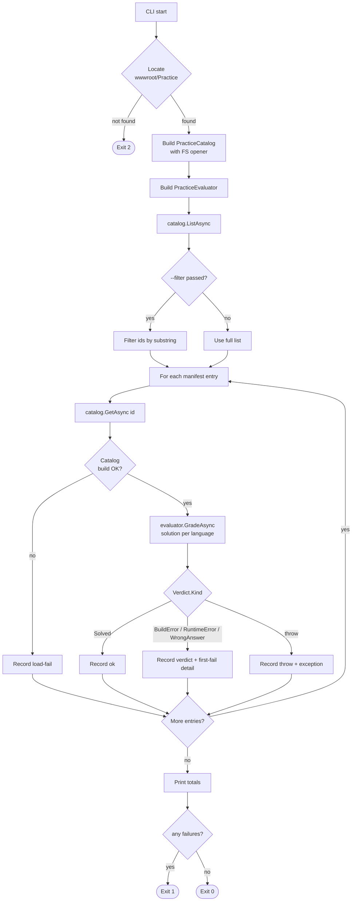
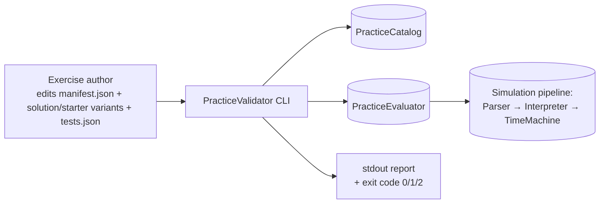
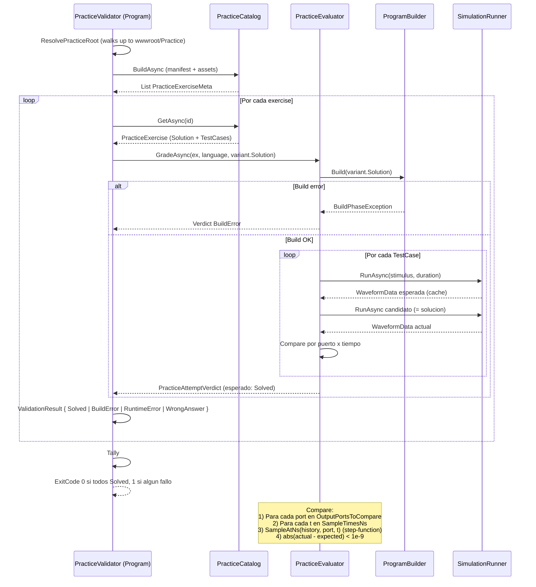

# PracticeValidator

CLI tool that grades every canonical solution shipped under `wwwroot/Practice/` against
its own self-tests, so we can detect dud exercises (parse failures, broken solutions,
or test cases that don't actually match the canonical answer) before students hit them.

## Project: Kmila-9s

Part of **Kmila-9s** — *Aplicación Multiplataforma para el Aprendizaje y Depuración de
Código VHDL sin Requerimiento de Hardware Físico* (TT 2026-B059, IPN ESCOM).

**Author:** Ulrich Tamayo Daniel
**Last verified:** 2026-08-03

> **Docs sync 2026-09-24** — no functional change to this tool this cycle; the
> 2026-09-23 feature batch (v1.27.0) is **app-only** (see `App/Kmila/README.md` §19).

---

## What it does

`PracticeValidator` is a stand-alone console executable that:

1. Walks up from the current working directory until it finds
   `App/Kmila/Kmila.Shared/wwwroot/Practice/` (so it can be launched from the repo
   root, from `App/Kmila/`, or from inside the tool itself).
2. Loads the practice catalog through the same `PracticeCatalog` /
   `PracticeEvaluator` services that the runtime app uses, just wired to a plain
   filesystem opener instead of MAUI's content stream.
3. Iterates over every entry in `manifest.json` (optionally filtered) and asks the
   evaluator to grade each language variant's solution (manifest schema v2,
   `variants.<lang>.solution`) against its own test cases. A missing variant is a failure.
4. Prints a per-exercise verdict (`OK`, `BUILDERROR`, `WRONGANSWER`, `RUNTIMEERROR`,
   `LOAD-FAIL`, `THROW: <type>`) plus a final tally grouped by failure class.

A green run guarantees that every shipped solution parses, simulates, and matches
its own self-grader. A red run flags exercises that need fixing.

## How to run

From the repo root:

```bash
dotnet run --project PracticeValidator
```

Filter to a subset of exercises by id substring (case-insensitive):

```bash
dotnet run --project PracticeValidator -- --filter half-adder
```

Build only (no run):

```bash
dotnet build PracticeValidator
```

## Exit codes

| Code | Meaning |
|------|---------|
| `0`  | All graded exercises returned `Solved`. |
| `1`  | At least one exercise failed grading (build error, wrong answer, runtime error, load failure, or thrown exception). |
| `2`  | Could not locate `wwwroot/Practice` while walking up from the current directory. |

## Inputs

- **`Practice/manifest.json`** — declares the list of exercises with their id,
  modality, and difficulty.
- **`Practice/<modality>/<difficulty>/<id>/<variants.<lang>.solution>`** (today `solution.vhdl`) — the canonical solution
  the validator grades.
- **`Practice/<modality>/<difficulty>/<id>/tests.json`** — the test cases used by
  `PracticeEvaluator` for grading.

Paths in the manifest are rooted at `Practice/`; the validator strips that prefix
since the resolver already points at the absolute Practice directory.

## Validation flow



## File walk

| File | Role |
|------|------|
| `PracticeValidator.csproj` | net9.0 console exe; references `App/Kmila/Kmila.Shared/Kmila.Shared.csproj` for the catalog + evaluator + models. Suppresses `CS1591`/`CS1998`/`NETSDK1206`. Sets `ServerGarbageCollection=false` to favour Workstation GC. |
| `Program.cs` | Single-file program. |

### `Program.cs` — key declarations

| Symbol | Lines | Purpose |
|---|---|---|
| `Program` (class) | `Program.cs:35` | Static host class for the validator. |
| `Program.Main` | `Program.cs:51` | Async entry point — orchestrates resolve → catalog/evaluator init → per-exercise grade → tally → exit code. Accepts `--audit-starters` flag (`Program.cs:89`) that writes `audit-starters.md` (`Program.cs:269`) — a report of every starter exercise that passes without the student having to do anything. |
| `Program.ResolvePracticeRoot` | `Program.cs:368` | Walks up the directory tree looking for `App/Kmila/Kmila.Shared/wwwroot/Practice` (and a few alternative roots so the tool works from inside `App/Kmila/`). |
| `Program.ValidationResult` (record) | `Program.cs:397` | Per-exercise grading outcome (`Id`, `Status`, optional `Detail`). |

The program uses `Microsoft.Extensions.Logging.Abstractions.NullLogger<T>` for both
`PracticeCatalog` and `PracticeEvaluator` so the tool's stdout stays a clean,
parseable stream of validation lines.

## Where it fits in the pipeline



`PracticeEvaluator.GradeAsync` reuses the same simulation pipeline that powers the
in-app practice mode. So a green validator run is direct evidence that the
exercises will grade correctly inside the application as well.

## Notes

- The validator runs grading **synchronously, one exercise at a time**, to keep the
  log linear and easy to scan.
- Exit code `1` is returned for any non-`ok` status; the breakdown by failure class
  is printed at the bottom for triage.
- Output is uncolored ASCII so it pipes cleanly into CI logs.

## Audit diagrams (2026-05-09)

This module also lives in `Documentacion/TT1/diagrams/` as `.mmd` source. The block
below is the canonical sequence diagram for the CLI grading flow.

### `fig_5_8_5_seq_practice_grading` — Practice grading sequence


